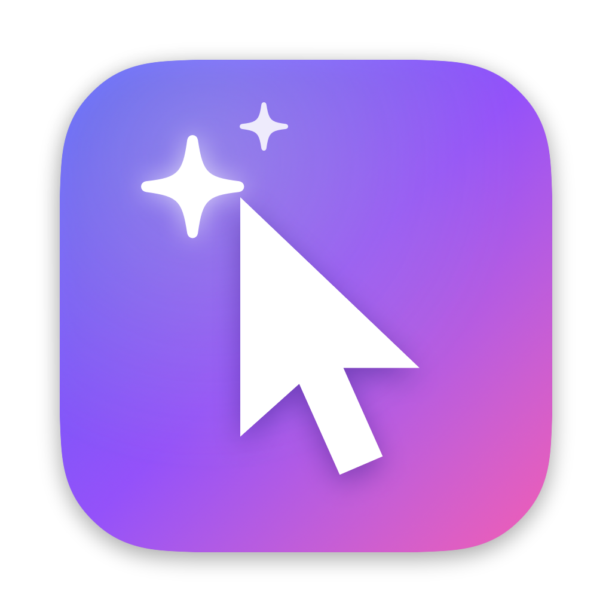

<p align="center"></p>

<h1 align="center">Do</h1>

<p align="center">Tell your Mac what to do. Do sees the screen, moves the pointer, types, and runs shell commands, <b>entirely on-device</b>.</p>

Do is a macOS app built on Microsoft's [Mage-VL-Cowork](https://huggingface.co/microsoft/Mage-VL-Cowork), a 4B-parameter computer-use model that chooses, turn by turn, between acting in the GUI (`computer_use`) and in the terminal (`bash`). Do runs a 4-bit MLX build of it ([pratikgx/Mage-VL-Cowork-MLX-4bit](https://huggingface.co/pratikgx/Mage-VL-Cowork-MLX-4bit)) through a native Swift port of the model on [mlx-swift](https://github.com/ml-explore/mlx-swift). No Python, no server, no network after the one-time model download.

## Using Do

1. Open Spotlight (**⌘ Space**), type **Do**, and pick the *Do* action.
2. Describe the task, e.g. *“Turn on Dark Mode”* or *“Make a folder on the Desktop called Receipts and move today’s PDFs into it”*, then press Return.
3. Do's island appears around the notch (or as a pill under the menu bar on displays without one) and Do's own cursor starts working.
   - The island shows a spinner, a running one-line summary of the current step, and an **✕** to stop. Click it to expand the reasoning and recent steps.
   - The agent cursor glides to each target, ripples on clicks, turns into a scroll indicator while scrolling, and labels typing, shortcuts, and shell commands.
4. To stop, press **Escape**. The island will read *“Stop now — press Escape again”*; a second press stops Do and releases the computer.

Do also accepts tasks from `doapp://run?task=…` URLs (e.g. `open "doapp://run?task=Open%20Calculator"`), and from the *Try it* box in its window (launch Do again from Finder or Spotlight to open it).

**Safety.** The model was trained in disposable VMs; Do runs it on your real Mac. By default Do asks before running shell commands that look destructive, privileged, or that send data elsewhere (`rm -r`, `sudo`, `curl … | sh`, `git push`, installs, …). Change this in Settings. Commands run in `~/Library/Application Support/Do/Workspace` with no terminal attached, so interactive prompts fail instead of hanging.

### Requirements

- Apple silicon Mac, **macOS 26** or later, 16 GB of memory recommended.
- ~3.2 GB of disk for the model (downloaded on first use, verified by SHA-256).
- Permissions: **Accessibility** (input) and **Screen Recording** (seeing the screen). Do's window walks you through both.

## Architecture

```
App/                     macOS app (SwiftUI + AppKit), generated by XcodeGen from project.yml
  Sources/App/           AppController (coordinator), model lifecycle, settings, Escape monitor, Sparkle
  Sources/Intents/       DoTaskIntent: the Spotlight action
  Sources/Overlay/       Island (notch / Dynamic Island / floating pill) and the agent cursor overlay
  Sources/Windows/       Onboarding/status window, Settings
Packages/DoKit/          Swift package
  Sources/DoCore/        Agent harness: Mage system prompt, sliding-window history, response parser,
                         chat template, CGEvent input, ScreenCaptureKit capture, shell runner,
                         command safety, model download. No MLX: builds and tests in seconds.
  Sources/MageVL/        Native MLX port of Mage-VL (Mage-ViT + Qwen3-4B), image processor,
                         runtime with prompt-prefix and vision-feature caching, parity diagnostics.
  Sources/mage-cli/      Developer CLI: parity checks and single-turn runs on a screenshot.
scripts/                 DMG packaging, signing, notarization, appcast, parity export
.github/workflows/       CI (tests + DMG on every push) and Release (on SemVer tags)
```

See [docs/ARCHITECTURE.md](docs/ARCHITECTURE.md) for the model port, the agent loop, and design decisions.

## Development

```bash
brew install xcodegen
make test        # DoCore unit tests
make build       # Build Do.app (ad-hoc signed) → build/DerivedData/Build/Products/Release/Do.app
make open        # Generate and open Do.xcodeproj
make cli         # mage-cli for model work
make dmg VERSION=0.1.0
```

Ad-hoc signed builds get a new code signature on every rebuild, so macOS asks for Accessibility and Screen Recording again. To keep permissions across rebuilds, sign locally with your team: create `Config/Local.xcconfig` with

```
CODE_SIGN_IDENTITY = Apple Development
DEVELOPMENT_TEAM = YOURTEAMID
```

### Model parity

The Swift port is checked against stock mlx-vlm 0.7.11:

```bash
python3 -m venv .venv && .venv/bin/pip install "mlx-vlm==0.7.11"
.venv/bin/python scripts/parity/export_reference.py --model "$HOME/Library/Application Support/Do/Models/pratikgx/Mage-VL-Cowork-MLX-4bit" \
    --image screenshot.png --task "Switch the system appearance to Dark mode." --out ref/
make cli && Packages/DoKit/.build/xcode/Build/Products/Release/mage-cli parity --ref ref/
```

Current result: identical prompt text and token IDs, matching patch grid, final-token logits at cosine 0.9992 with identical top-5.

## Releasing

Releases are cut by pushing a SemVer tag; see [docs/RELEASING.md](docs/RELEASING.md).

```bash
git tag v0.1.0-rc.1 && git push origin v0.1.0-rc.1   # pre-release
git tag v0.1.0 && git push origin v0.1.0             # release (served to Sparkle auto-update)
```

## Licenses

Mage-VL-Cowork and the MLX conversion are Apache-2.0. MLX, mlx-swift-lm, swift-transformers, and Sparkle are under their respective licenses.
